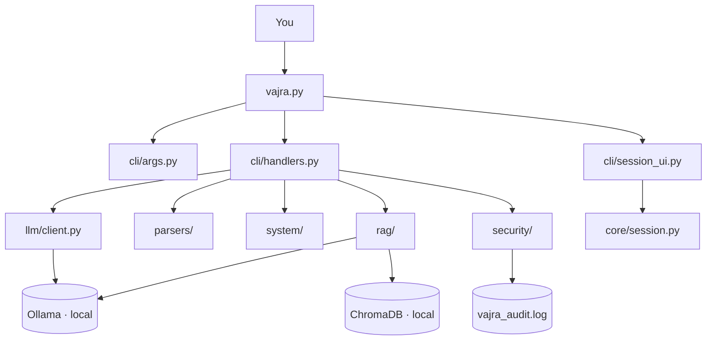

# ⚡ VAJRA (वज्र)

**A local, offline AI assistant for Linux, Windows, and Ubuntu technical work — no cloud, no API key, no subscription.**

   

VAJRA runs entirely on your machine through [Ollama](https://ollama.com). Every query, every document you feed it, every command it helps you run — none of it ever leaves your computer.

```bash
python vajra.py -m linux "set up a cron job that runs every 5 minutes"
python vajra.py library add networking_book.pdf
python vajra.py ask "what does the book say about ARP spoofing?"
```

---

## Why VAJRA

Most AI CLI tools need a subscription and send your data to a server somewhere. VAJRA doesn't. It's built for people who want real AI assistance for daily technical work — Linux administration, code review, security research, document analysis — without the cloud dependency.

| | VAJRA | Typical cloud AI CLI |
|---|---|---|
| Runs offline | ✅ | ❌ |
| API key required | ❌ | ✅ |
| Your files/queries leave your machine | Never | Usually |
| Executes commands without asking | Never | Varies |
| Local knowledge base with citations | ✅ | Rare |

---

## Features

- **Six specialist modes** — `linux`, `dev`, `sysadmin`, `cyber`, `doc`, and `default`, each with its own persona and response structure
- **File intelligence** — reads and analyses PDF, DOCX, TXT, MD, logs, configs, and source code
- **Local knowledge library (RAG)** — add your own PDFs/notes, then `ask` questions grounded in them with page-level citations
- **System awareness** — live CPU/RAM/disk/network snapshots and service status, cross-platform via `psutil`
- **Gated command execution** — VAJRA can run a command for you, but only the exact one you type, classified (safe/modifying/dangerous/blocked) and confirmed before anything happens
- **Secret protection** — scans files for likely credentials before reading them, and redacts secrets from anything it saves to disk
- **Full model flexibility** — swap between any Ollama model per-query, permanently, or mid-session, with RAM warnings before you load something too big

---

## Architecture



Every box runs on your machine. The only network calls VAJRA ever makes are to `localhost:11434` — your own Ollama instance.

---

## Installation

**1. Install Ollama** — [ollama.com/download](https://ollama.com/download)

**2. Pull a chat model and the embedding model**
```bash
ollama pull gemma4:e4b          # or llama3.1:8b, mistral:7b, etc.
ollama pull nomic-embed-text    # needed for the library/ask feature
```

**3. Clone and install dependencies**
```bash
git clone https://github.com/yourusername/vajra.git
cd vajra
pip install -r requirements.txt
```

**4. Run it**
```bash
python vajra.py -h
```

**Optional — make it a system command on Linux:**
```bash
chmod +x vajra.py
sudo cp vajra.py /usr/local/bin/vajra
vajra -h
```

---

## Usage

### One-off questions
```bash
python vajra.py "how do I find files larger than 1GB in Linux"
python vajra.py -m dev "explain what a Python decorator does"
python vajra.py -m sysadmin "nginx keeps returning 502"
python vajra.py -m cyber "what is blind SQL injection"
```

### File analysis
```bash
python vajra.py read report.pdf "summarise the key findings"
python vajra.py -m dev read script.py "review this for bugs"
```

### System diagnostics
```bash
python vajra.py sysinfo
python vajra.py sysinfo "is anything wrong with my system?"
python vajra.py service nginx
```

### Your own knowledge library
```bash
python vajra.py library add textbook.pdf notes.md
python vajra.py library list
python vajra.py ask "explain ARP spoofing" --source-mode source-only
```

### Running commands (with a safety gate)
```bash
python vajra.py run "ls -la"          # safe — runs immediately
python vajra.py run "mkdir project"   # modifying — asks you to confirm first
python vajra.py audit                 # see everything VAJRA has run
```

### Interactive session (with memory)
```bash
python vajra.py -s
```
```
VAJRA [DEFAULT] > mode sysadmin
VAJRA [SYSADMIN] > my nginx server keeps crashing under load
VAJRA [SYSADMIN] > sysinfo
VAJRA [SYSADMIN] > library add postmortem.pdf
VAJRA [SYSADMIN] > ask what did we conclude last time this happened?
```

---

## Modes

| Mode | Best for |
|---|---|
| `default` | General Linux/Windows/Ubuntu technical questions |
| `linux` | Shell commands, scripting, distro-specific workflows |
| `dev` | Code review, debugging, refactoring |
| `sysadmin` | Log analysis, server issues, networking, infrastructure |
| `cyber` | CTF (hint-ladder coaching), bug bounty, payload crafting, recon |
| `doc` | Summarising and answering questions about a specific document |

---

## Security model

VAJRA can execute a command through `run`, but three rules are absolute:

1. **You always choose the command.** VAJRA never reads its own AI-generated reply and runs a command from it automatically.
2. **Every command is classified** — safe / modifying / dangerous / blocked — and anything beyond "safe" requires you to type `y`, every single time, with no "trust this session" shortcut.
3. **Some patterns are blocked outright** (`rm -rf /`, `mkfs`, disk-wipe commands) with no override.

Classification is a best-effort safety net, not a guarantee — full policy in [SECURITY.md](./SECURITY.md).

---

## Model flexibility

VAJRA isn't locked to one model:
```bash
python vajra.py --list-models              # see what's available + RAM guidance
python vajra.py --set-model llama3.1:8b     # change the default permanently
python vajra.py --model mistral:7b "..."    # use a different model just once
```
Inside a session: `setmodel <name>` switches live.

---

## Project structure

```
vajra.py              entry point
core/                  config, session memory, logging
llm/                    Ollama client, model management, mode prompts
parsers/                 PDF / DOCX / text / code readers
rag/                      local knowledge library — chunking, embeddings, retrieval
security/                  command classification, gated execution, secret redaction, audit log
system/                     cross-platform system intelligence (psutil)
cli/                         argument parsing, display, interactive session
tests/                        unit tests
```

---

## Running tests
```bash
python -m pytest tests/ -v
```

---

## Ethical use

VAJRA's `cyber` mode is built for authorised penetration testing, CTF competitions, and bug bounty programmes with explicit scope. It will not help attack a system you don't have permission to test. See [SECURITY.md](./SECURITY.md) for the full policy.

---

## Background

VAJRA — **वज्र**, Indra's thunderbolt in Hindu mythology — was built as a personal local-AI toolkit by a Cyber Security & Digital Forensics student in Mumbai, with a background in CTF and bug bounty work. It's part of a small portfolio of local-first AI security tools.

---

## License

MIT — see [LICENSE](./LICENSE).

*वज्र — Sharp. Precise. Unstoppable.*
